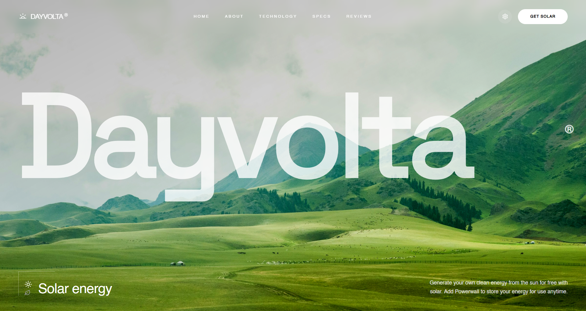

# Dayvolta — Solar Landing Page

A polished, single-page marketing site for **Dayvolta**, a concept residential
solar + home-battery brand. It tells the product story across a hero, savings
overview, service steps, a product showcase, system specs, scrolling reviews,
and a footer with a working newsletter form.

**Live demo:** https://dayvolta-solar.vercel.app

> **Concept notice** — this is a front-end portfolio project. Dayvolta is not a
> real company, and there is no backend, payment system, or email service.
> Product metrics, reviews, specs, and availability shown on the site are
> illustrative sample content, and the site labels them as such in-page.



## Brand

The project began as a clone of a public "Goreno" solar concept design. To make
it an independent work, it was rebranded to **Dayvolta** — *day* + *Volta*
(Alessandro Volta, pioneer of electricity). The name was checked for obvious
collisions and its `.com` registration status was confirmed **unregistered**
via Verisign RDAP at the time of writing (no domain was purchased). A custom
sunrise logo mark (SVG, defined in `src/components/Logo.jsx`) and a matching
favicon carry the identity across the header, mobile menu, footer, and browser
tab, and the name is applied consistently in metadata, social previews, package
name, and documentation.

## Key features & interactions

- **Sticky adaptive header** — transparent over the hero, frosted light bar once
  scrolled, staying legible on both light and dark sections.
- **Working in-page navigation** — every link smooth-scrolls to its section
  (`#home`, `#about`, `#technology`, `#specs`, `#reviews`, `#contact`) with a
  fixed-header offset.
- **Animated full-screen mobile menu** with staggered link reveals (Framer
  Motion) and a correctly layered close control.
- **Interactive energy chart** — hovering a bar updates the displayed value
  (clearly badged as *Sample Metrics*, not live data).
- **Vertical marquee reviews** with an explicit "illustrative sample content"
  footnote.
- **Validated newsletter form** (react-hook-form): required + email-format
  errors, submitting state, and an honest local confirmation — nothing is sent
  anywhere.
- **Accessibility**: keyboard focus outlines, `aria-label`/`aria-expanded`,
  labelled form input, `role="alert"`/`role="status"` feedback, and a
  `prefers-reduced-motion` fallback that disables animations and smooth scroll.
- **Honest UI**: decorative controls are non-interactive, secondary CTAs point
  to real sections (`#contact`, `#technology`, `#about`), and there are no
  dead `href="#"` links.

## Tech stack (verified)

| Layer      | Choice                                               |
|------------|------------------------------------------------------|
| Framework  | React 19                                             |
| Build tool | Vite 7 (`@vitejs/plugin-react`)                      |
| Styling    | Tailwind CSS v4 (`@tailwindcss/vite`)                |
| Animation  | Framer Motion 12                                     |
| Icons      | lucide-react (+ custom inline SVG brand mark)        |
| Forms      | react-hook-form                                      |
| Linting    | ESLint 9 (flat config) + react-hooks / react-refresh |

Fonts are self-hosted locally (Helvetica, Space Grotesk) — no external font
requests.

## Architecture & directory structure

Single-page app rendered directly by `App.jsx` (no client-side router). Each
section is its own component; sample content lives in `assets/data.jsx`.

```
├─ index.html              # App shell, Dayvolta metadata, favicon
├─ public/
│  ├─ favicon.svg          # Dayvolta sunrise mark
│  ├─ fonts/               # Self-hosted Helvetica, Space Grotesk
│  └─ images/              # Hero, product, service, avatar imagery
├─ src/
│  ├─ App.jsx              # Composes all sections in order
│  ├─ main.jsx             # React root
│  ├─ index.css            # Tailwind v4, fonts, theme tokens, a11y rules
│  ├─ assets/
│  │  └─ data.jsx          # navLinks, chartData, specs, services, reviews
│  └─ components/
│     ├─ Logo.jsx          # Custom sunrise mark + wordmark lockup
│     ├─ Navigation.jsx    # Adaptive header + mobile menu
│     ├─ Hero.jsx          # #home
│     ├─ About.jsx         # #about — savings + interactive chart
│     ├─ Services.jsx      # consultation-to-power-on steps
│     ├─ ProductShowcase.jsx # #technology — battery showcase
│     ├─ More.jsx          # #specs — system specs + previews
│     ├─ Testimonials.jsx  # #reviews — marquee (illustrative)
│     └─ Footer.jsx        # #contact — CTA + validated newsletter
└─ docs/preview.png        # README screenshot (actual site)
```

## Prerequisites

- **Node.js 18+** (developed and verified on Node 24)
- npm (bundled with Node)

## Getting started

```bash
npm install        # install dependencies
npm run dev        # dev server at http://localhost:5173
npm run lint       # ESLint over the repo
npm run build      # production build -> dist/
npm run preview    # serve the production build locally
```

## Environment variables

None. Fully static front-end with no secrets or services.

## Deployment

The build outputs a static `dist/` folder for any static host. For Vercel:

```bash
npm i -g vercel
vercel link --yes --project dayvolta-solar
vercel deploy --prod --yes
# Framework preset: Vite • Build: npm run build • Output: dist
```

## Implementation notes

- **Performance**: local fonts/images only; no analytics or third-party
  requests. Production JS is ~118 KB gzipped.
- **Motion**: all reveal/hover/marquee animations honor `prefers-reduced-motion`.
- **Semantics**: sections are landmarked with stable ids reused by nav and
  footer links.

## Known limitations

- Newsletter confirmation is local-only; no email is sent or stored.
- Reviews, metrics, and product availability are illustrative concept content
  (labeled in-page).
- "Order now" opens a `mailto:` to the concept address; social pills are
  decorative.

## License & attribution

Layout and concept direction inspired by the publicly shared
["Goreno – Solar Energy Landing Page" design on Dribbble](https://dribbble.com/shots/25005707-Goreno-Solar-Energy-Landing-Page)
by Royhan Muhammad; this repository is an independent re-implementation,
rebranded to Dayvolta with original code and copy. The site imagery in
`public/images/` was included with the starting project and is used here for
non-commercial demonstration purposes. Add a license of your choice before
publishing if you reuse this code.
